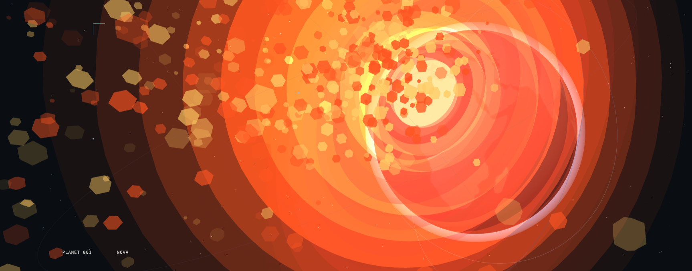
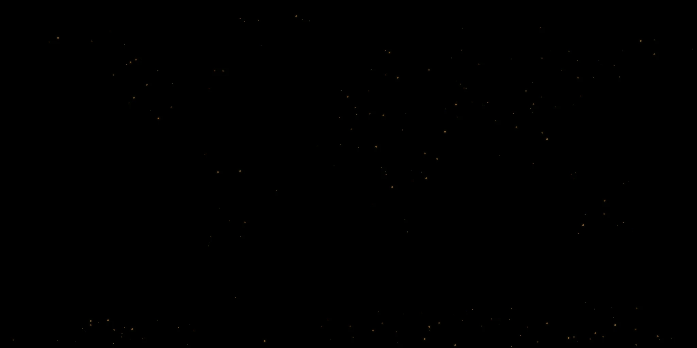

<h1>
  
  IsolatedWorld
</h1>
Personal Website, Profilio, Projects, Fun

## **Overview:**

- This is ment to be a home for exploring projects and documentation, and a profilio for others who want to see my work!

## Build:

Heres how to build and run the server

1. Go to server and run npm install
2. then do npm start to run the server and it would run on your local machine
3. Go to http://localhost:3000

Otherwise, just open index.html at root to view the website.

## Favorite Parts

- **Animated welcome title** - Custom censor-bar transition between IsolatedWorld and My Universe.
- **Interactive visuals** - A 3D planet built with Three.js.
- **Terminal details** - Clean typography with a technical aesthetic.
- **Responsive layout** - Adapts to smaller screens.
- **Motion accessibility** - Reduced-motion support.
- **EXPLODING PLANET ** - Right-click Earth to launch a nuke!

anyways **NUKE** (right click planets)

Repo Status: This repo is never gonna stop updating beacuse every weekend is a new project!

I really want to move to a live server with nodejs and all of that to make this a fun experience for you all.

## Author

Created by **IsoDev** ( *Isolated Dev* - xisolatedev / Elkon Mechato).
